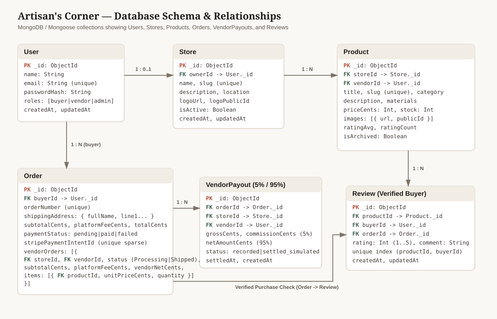

# Artisan's Corner — Multi-Vendor Handmade Goods Marketplace

Artisan's Corner is a full-stack multi-vendor marketplace built for the Persevex Web Development Internship. Independent makers create studio storefronts, upload product photography to Cloudinary, manage inventory and fulfillment, and track real order-backed earnings, while buyers browse one unified catalog, maintain a persistent multi-vendor cart, check out securely via Stripe Test Mode, and leave verified-purchase reviews.

## Core Features
- **Roles & Store Onboarding**: Supports `buyer`, `vendor`, and `admin` roles (a user can be both buyer and vendor). Standard users upgrade via **Become a Seller** with a Store Profile (`Name`, `Location`, `Description`, Cloudinary `Logo`).
- **Vendor Studio Dashboard (`/dashboard/seller`)**: Protected product CRUD table, Cloudinary multi-image uploads, real sales-history & net-earnings analytics (Recharts), per-vendor order fulfillment (`Processing` / `Shipped`), and a 5% commission / 95% payout ledger (simulated payout settlement).
- **Marketplace Discovery**: Editorial storefront (`/`), filterable/searchable/paginated catalog (`/shop`), detailed product gallery pages (`/products/:slug`), and public studio pages (`/stores/:slug`).
- **Persistent Multi-Vendor Cart & Checkout**: Redux Toolkit + `localStorage` cart grouped by maker studio, shipping address validation, server-side price/stock recalculation, and Stripe `PaymentIntent` verification (cart clears only after server-confirmed payment).
- **Verified Buyer Reviews**: 1–5 star ratings and text reviews strictly gated to buyers with a paid order containing that product (with duplicate-review protection).
- **Admin Console (`/dashboard/admin`)**: Platform GMV, 5% commission revenue overview, store activation/suspension, and catalog moderation.

## Architecture & Tech Stack
- **Frontend (`client/`)**: React 18, TypeScript, Vite, Redux Toolkit, React Router v6, Axios, Tailwind CSS (custom warm-craft design tokens), Lucide React, Recharts, `@stripe/react-stripe-js`.
- **Backend (`server/`)**: Node.js, Express.js, TypeScript (`config → models → validators → middleware → services → controllers → routes`), `bcryptjs`, `jsonwebtoken`, `multer` 2.x, Zod, Helmet, CORS.
- **Database**: MongoDB + Mongoose ODM (chosen for flexible product metadata, `.populate()` store/user relationships, compound unique review/payout indexes, and embedded purchase-time order snapshots).
- **External Services**: Cloudinary (image hosting), Stripe API (`PaymentIntent` + webhook verification in Test Mode).

## Database Schema Diagram


## Environment Variables
Create `server/.env` (from `server/.env.example`) and `client/.env` (from `client/.env.example`). Never commit real secrets.

### `server/.env`
- `PORT` — API port (default `5000`)
- `NODE_ENV` — `development` | `production`
- `MONGODB_URI` — MongoDB Atlas connection string
- `JWT_SECRET` — Long random secret (min 16 chars)
- `JWT_EXPIRES_IN` — Token lifetime (default `7d`)
- `CLIENT_URL` — Allowed frontend origin(s), e.g. `http://localhost:5173`
- `CLOUDINARY_CLOUD_NAME`, `CLOUDINARY_API_KEY`, `CLOUDINARY_API_SECRET` — Cloudinary credentials
- `STRIPE_SECRET_KEY`, `STRIPE_WEBHOOK_SECRET` — Stripe Test Mode keys
- `PLATFORM_COMMISSION_BPS` — `500` (5% platform fee)

### `client/.env`
- `VITE_API_URL` — Backend API base URL (e.g. `http://localhost:5000/api`)
- `VITE_STRIPE_PUBLISHABLE_KEY` — Stripe Test Mode publishable key (`pk_test_...`)

## Local Setup & Seeding
```bash
# 1. Server
cd server
cp .env.example .env
# Fill in your MongoDB Atlas, JWT, Cloudinary, and Stripe test keys
npm install
npm run seed
npm run dev

# 2. Client (new terminal)
cd client
cp .env.example .env
# Fill in VITE_STRIPE_PUBLISHABLE_KEY
npm install
npm run dev
```

## Demo Credentials (Created by `npm run seed`)
| Role | Email | Password |
|---|---|---|
| **Demo Buyer** | `buyer@artisanscorner.demo` | `DemoBuyer123!` |
| **Demo Vendor 1** | `vendor@artisanscorner.demo` | `DemoVendor123!` |
| **Demo Vendor 2** | `weaver@artisanscorner.demo` | `DemoVendor123!` |
| **Demo Admin** | `admin@artisanscorner.demo` | `DemoAdmin123!` |

## API Overview
- **Auth**: `POST /api/auth/register`, `POST /api/auth/login`, `POST /api/auth/logout`, `GET /api/auth/me`
- **Stores**: `GET /api/stores`, `GET /api/stores/:slug`, `POST /api/stores/become-seller`, `GET/PATCH /api/stores/me`
- **Products**: `GET /api/products`, `GET /api/products/:slug`, `GET /api/products/mine`, `POST /api/products`, `PATCH/DELETE /api/products/:id`
- **Reviews**: `GET /api/products/:id/reviews`, `GET /api/products/:id/reviews/eligibility`, `POST /api/products/:id/reviews`
- **Orders & Payments**: `POST /api/orders/validate-cart`, `GET /api/orders/my`, `GET /api/orders/:id`, `POST /api/payments/create-intent`, `POST /api/payments/verify`, `POST /api/webhooks/stripe`
- **Seller**: `GET /api/seller/products`, `GET /api/seller/analytics`, `GET /api/seller/orders`, `PATCH /api/seller/orders/:orderId/status`, `GET /api/seller/payouts`, `POST /api/seller/payouts/:payoutId/simulate-settle`
- **Admin**: `GET /api/admin/overview`, `GET /api/admin/stores`, `PATCH /api/admin/stores/:id/status`, `GET /api/admin/products`, `PATCH /api/admin/products/:id/archive`

## Testing
```bash
cd server
npm run typecheck
npm run build
npm test

cd ../client
npm run typecheck
npm run build
```

## Deployment Guide
- **Backend (Render)**: Deploy using [render.yaml](./render.yaml) (`rootDir: server`, `npm install && npm run build`, `npm start`) and set production secrets + `CLIENT_URL` to your Vercel domain.
- **Frontend (Vercel)**: Deploy `client/` with [client/vercel.json](./client/vercel.json) SPA rewrites and configure `VITE_API_URL` + `VITE_STRIPE_PUBLISHABLE_KEY`.

## Known Limitations & Scope Notes
- **Payout Simulation**: Per the Persevex project brief, vendor payouts record the 5% platform fee / 95% net split and support simulated settlement (`recorded` → `settled_simulated`) rather than automated Stripe Connect bank transfers.
- **Seed Images**: The demo seed script populates sample product photos using curated HTTPS image URLs; all vendor-uploaded logos and product photos created in the app upload directly to Cloudinary.
- **Live Verification**: Automated tests run against an in-memory MongoDB server with mocked Cloudinary and Stripe SDK layers; live cloud uploads and Stripe Test Mode card charges require valid credentials in `.env`.
