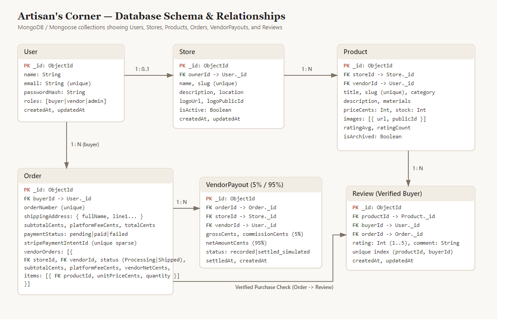

# Artisan's Corner — Multi-Vendor Handmade Goods Marketplace

[](file:///d:/PROJECTS/Artisan's%20Corner/server/tests)
[](file:///d:/PROJECTS/Artisan's%20Corner)
[](file:///d:/PROJECTS/Artisan's%20Corner/server/tests/security.test.ts)
[](file:///d:/PROJECTS/Artisan's%20Corner/client/src/styles/tokens.css)

Artisan's Corner is a production-grade multi-vendor marketplace designed for bespoke handmade goods and independent studios. Built for the Persevex Web Development Internship, the platform connects discerning buyers directly with master craftspeople across ceramics, textiles, woodwork, leatherwork, and fine metals.

Independent makers create studio storefronts, upload photography with binary-verified file inspection, manage small-batch inventory and fulfillment, and inspect real ledger-backed earnings, while buyers browse an editorial catalog, maintain a persistent multi-vendor cart, check out via Stripe, and publish verified-purchase reviews.

---

## 🎨 Editorial Atelier Design System

The client interface has been transformed into a warm, tactile digital atelier inspired by physical print catalogs, studio notebooks, and heritage craft galleries:

- **Warm Atelier Palette**: Neutral linen paper canvas (`#FAF7F2` / `#F3EFEA`), terracotta action accents (`#C85A32`), artisan sage badges (`#4A6B5D`), and rich walnut typography (`#241C16`).
- **Heritage Typography**: Editorial serif headings powered by *Fraunces* paired with clean, accessible geometric UI numerals.
- **Craft Taxonomy & Badges**: Material composition micro-badges (e.g., *100% European flax*, *Buff stoneware*), studio origin indicators (*Portland, OR*, *Burlington, VT*), and small-batch scarcity meters.
- **Transparent Maker Economics**: Direct-to-artisan breakdown surfaced at Cart and Checkout (guaranteeing 95% net to makers with a 5% platform commission).
- **Artisan Studio Workbench**: Professional vendor dashboard featuring sales analytics, dispatch fulfillment, and payout ledgers.

---

## 🛡️ Enterprise Security Hardening

The backend features multi-layered defenses verified by automated security suites:

1. **Atomic Inventory Decrements with Rollback (`paymentService.ts`)**:
   - Stock decrements run atomically in parallel via MongoDB `$inc: { stock: -qty }` with condition `{ stock: { $gte: qty } }`.
   - Any partial stock depletion triggers an automated compensatory rollback restoring previously decremented items.
2. **Buffer Magic-Byte Validation (`uploadService.ts`)**:
   - Rejects uploaded image buffers whose initial bytes do not match true image signatures (JPEG `FF D8 FF`, PNG `89 50 4E 47`, WebP `RIFF....WEBP`), preventing disguised executable payloads.
3. **Timing-Attack Resistant Authentication (`authService.ts`)**:
   - When an email is not registered, the system performs a constant-time dummy bcrypt comparison against a pre-hashed dummy string, neutralizing timing-based email enumeration.
4. **Strict Query Schema & ReDoS Sanitization (`productValidator.ts` & `productService.ts`)**:
   - Catalog search queries are strictly length-capped and special regex characters are escaped to prevent catastrophic regex backtracking.
5. **Store Suspension Integrity (`storeService.ts`)**:
   - Prohibits product modifications or store profile edits on suspended studios.
6. **Multi-Tier Rate Limiting & Helmet CSP (`app.ts`)**:
   - Tiered limits on authentication (15 requests / 15 min), payment intents (15 requests / 15 min), and global API traffic (300 requests / 15 min).
   - Strict Helmet Content Security Policy and CORS origin whitelisting.

---

## 🏗️ Architecture & Tech Stack

- **Frontend (`client/`)**: React 18, TypeScript, Vite, Redux Toolkit, React Router v6, Axios, Tailwind CSS (bespoke craft tokens), Lucide React, Recharts, `@stripe/react-stripe-js`.
- **Backend (`server/`)**: Node.js, Express.js, TypeScript (`config → models → validators → middleware → services → controllers → routes`), `bcryptjs`, `jsonwebtoken`, `multer` 2.x, Zod, Helmet, Express Rate Limit.
- **Database**: MongoDB Atlas + Mongoose ODM (relational indexing, compound unique constraints, purchase-time order snapshots).
- **External Services**: Cloudinary (studio logo & product photography), Stripe API (`PaymentIntent` + webhook verification in Test Mode).

---

## 📊 Database Schema Diagram



---

## 📡 REST API Reference

The backend exposes a RESTful JSON API prefixed by `/api`. Secured routes require `Authorization: Bearer <jwt_token>` (or HTTP-only session cookie).

### Authentication (`/api/auth`)
| Method | Endpoint | Access | Description |
|---|---|---|---|
| `POST` | `/api/auth/register` | Public | Register buyer/artisan (`name`, `email`, `password`, `role`) |
| `POST` | `/api/auth/login` | Public | Constant-time authenticated sign-in; returns JWT |
| `POST` | `/api/auth/logout` | Public | Clears authentication session cookie |
| `GET` | `/api/auth/me` | Authenticated | Retrieves current authenticated session user profile |

### Artisan Stores (`/api/stores`)
| Method | Endpoint | Access | Description |
|---|---|---|---|
| `GET` | `/api/stores` | Public | List approved public artisan studios |
| `GET` | `/api/stores/:slug` | Public | Retrieve public studio details and active catalog |
| `POST` | `/api/stores/become-seller` | Authenticated | Onboard as artisan studio with logo upload (`multipart/form-data`) |
| `GET` | `/api/stores/me` | Vendor | Fetch current vendor's owned studio profile |
| `PATCH` | `/api/stores/me` | Vendor | Update store story, craft specializations, and location |

### Products & Reviews (`/api/products`)
| Method | Endpoint | Access | Description |
|---|---|---|---|
| `GET` | `/api/products` | Public | Paginated product search with craft category, price, and sorting |
| `GET` | `/api/products/:slug` | Public | Fetch product detail with populated studio information |
| `POST` | `/api/products` | Vendor | Create new craft listing with up to 5 image uploads |
| `PATCH` | `/api/products/:id` | Vendor / Admin | Update product details, inventory, pricing, or media |
| `DELETE` | `/api/products/:id` | Vendor / Admin | Delete owned product or archive listing |
| `GET` | `/api/products/mine` | Vendor | List all products owned by current artisan studio |
| `GET` | `/api/products/:id/reviews` | Public | List customer reviews and ratings for a product |
| `GET` | `/api/products/:id/reviews/eligibility` | Authenticated | Check if current user has an unreviewed verified purchase |
| `POST` | `/api/products/:id/reviews` | Authenticated | Submit verified-purchase review (enforces single review per buyer) |

### Orders & Cart Validation (`/api/orders`)
| Method | Endpoint | Access | Description |
|---|---|---|---|
| `POST` | `/api/orders/validate-cart` | Public | Server-side cart price, active status, and stock availability check |
| `GET` | `/api/orders/my` | Authenticated | Buyer order history with line items and shipment tracking |
| `GET` | `/api/orders/:id` | Authenticated | Single order details with itemized artisan breakdowns |

### Payments & Checkout (`/api/payments`)
| Method | Endpoint | Access | Description |
|---|---|---|---|
| `GET` | `/api/payments/config` | Public | Returns Stripe publishable key |
| `POST` | `/api/payments/create-intent` | Authenticated | Validates stock, calculates server totals, creates Stripe PaymentIntent |
| `POST` | `/api/payments/verify` | Authenticated | Verifies payment, creates order, decrements stock atomically, creates payouts |

### Seller Workbench (`/api/seller`)
| Method | Endpoint | Access | Description |
|---|---|---|---|
| `GET` | `/api/seller/analytics` | Vendor | Real-time revenue, order volume, net payouts, and top products |
| `GET` | `/api/seller/orders` | Vendor | Vendor-specific order fulfillment list |
| `PATCH` | `/api/seller/orders/:orderId/status` | Vendor | Update studio fulfillment status (`processing`, `shipped`, `delivered`) |
| `GET` | `/api/seller/payouts` | Vendor | Ledger of 95% net earnings per completed order |
| `POST` | `/api/seller/payouts/:payoutId/simulate-settle` | Vendor | Demo simulated bank transfer settlement |

### Admin Moderation (`/api/admin`)
| Method | Endpoint | Access | Description |
|---|---|---|---|
| `GET` | `/api/admin/overview` | Admin | Platform-wide GMV, active stores, order count, and system health |
| `GET` | `/api/admin/stores` | Admin | List all registered artisan studios |
| `PATCH` | `/api/admin/stores/:id/status` | Admin | Moderate store status (`approved`, `suspended`, `rejected`) |
| `GET` | `/api/admin/products` | Admin | Platform-wide catalog audit |
| `PATCH` | `/api/admin/products/:id/archive` | Admin | Archive or delist prohibited products |

---

## 🔑 Environment Configuration

Create `server/.env` (from `server/.env.example`) and `client/.env` (from `client/.env.example`).

### `server/.env`
```ini
PORT=5000
NODE_ENV=development
MONGODB_URI=mongodb+srv://<username>:<password>@<cluster>.mongodb.net/artisans_corner?retryWrites=true&w=majority
JWT_SECRET=your_jwt_secret_min_16_chars
JWT_EXPIRES_IN=7d
CLIENT_URL=http://localhost:5173
CLOUDINARY_CLOUD_NAME=your_cloud_name
CLOUDINARY_API_KEY=your_api_key
CLOUDINARY_API_SECRET=your_api_secret
STRIPE_SECRET_KEY=sk_test_placeholder_key
STRIPE_WEBHOOK_SECRET=whsec_placeholder_key
PLATFORM_COMMISSION_BPS=500
```

### `client/.env`
```ini
VITE_API_URL=http://localhost:5000/api
VITE_STRIPE_PUBLISHABLE_KEY=pk_test_placeholder_key
```

---

## 🚀 Quickstart & Local Seeding

### 1. Start the Backend
```bash
cd server
npm install
npm run seed       # Seeds demo artisan studios, products, and accounts
npm run dev        # Starts API on http://localhost:5000
```

### 2. Start the Frontend
```bash
cd client
npm install
npm run dev        # Starts Vite UI on http://localhost:5173
```

---

## 👥 Demo Test Accounts

Seeded with realistic artisan data (password for all: `DemoBuyer123!` / `DemoVendor123!` / `DemoAdmin123!`):

| Role | Name | Email | Password | Details |
|---|---|---|---|---|
| **Buyer** | Maya Buyer | `buyer@artisanscorner.demo` | `DemoBuyer123!` | Active buyer account with past orders |
| **Ceramics Artisan** | Clara Potter | `vendor@artisanscorner.demo` | `DemoVendor123!` | Owner of *Kiln & Birch Studio* (Portland, OR) |
| **Textile Artisan** | Owen Weaver | `weaver@artisanscorner.demo` | `DemoVendor123!` | Owner of *Loom & Flax Studio* (Burlington, VT) |
| **Admin** | Platform Admin | `admin@artisanscorner.demo` | `DemoAdmin123!` | Full platform administration & moderation |

---

## 🧪 Testing & Verification

Run the comprehensive Vitest test suite:

```bash
# Server Test Suite (14/14 tests passing)
npm test --prefix server

# TypeScript Strict Typecheck
npm run typecheck --prefix server
npm run typecheck --prefix client

# Production Build
npm run build --prefix client
```

### Test Suite Breakdown:
- **`tests/phase1.test.ts`**: Auth, password hashing, roles, store onboarding, image uploads, product ownership.
- **`tests/phase2.test.ts`**: Discovery catalog filtering, store profiles, seller analytics, non-fabricated earnings.
- **`tests/phase3_4.test.ts`**: Multi-vendor checkout, Stripe PaymentIntent, 5%/95% payout ledger, fulfillment dispatch, verified reviews.
- **`tests/security.test.ts`**: Buffer magic-byte enforcement, constant-time dummy comparisons, ReDoS safety, atomic stock compensation, suspension guards.

---

## 🚢 Deployment

- **Backend (Render / Railway)**: Deploy `server/` with `npm install && npm run build` and `npm start`. Configure environment variables and set `CLIENT_URL` to your production frontend domain.
- **Frontend (Vercel / Netlify)**: Deploy `client/` using [client/vercel.json](./client/vercel.json) for SPA routing rewrites. Set `VITE_API_URL` to your production backend URL.
